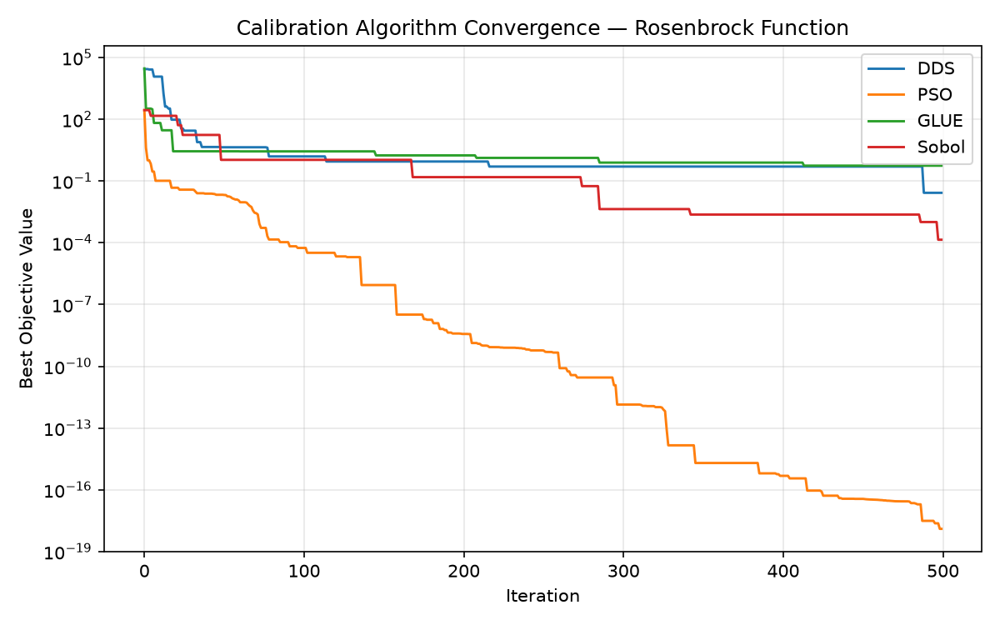

<!-- fingerprint:ca32486d0315fb412bf88be84b33c8a3 -->
# Calibration Algorithm Benchmarks

*Last updated: 2026-11-25 09:50 UTC*

Synthetic benchmark on the **Rosenbrock** test function f(x,y) = (1−x)² + 100·(y−x²)²  with random starting points.

| Algorithm | Iterations | Best Objective | Convergence Rate |
|-----------|-----------|----------------|------------------|
| DDS | 500 | 2.494801e-01 | 100.00% |
| PSO | 500 | 2.741869e-20 | 100.00% |
| GLUE | 500 | 2.666515e-01 | 99.96% |
| Sobol | 500 | 9.112435e-03 | 99.62% |

*Convergence rate = fraction of total improvement achieved in the first 20% of iterations.*
