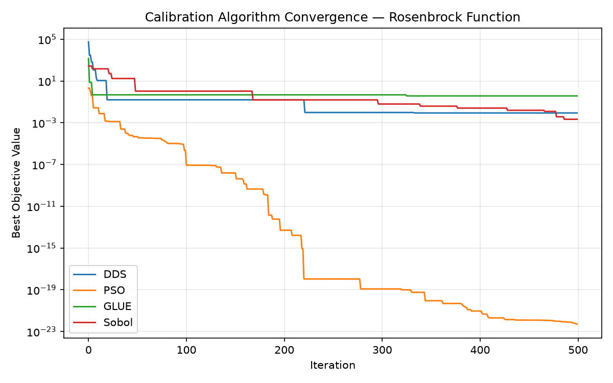

<!-- fingerprint:001fa0aeaefcca608630592f00156d40 -->
# Calibration Algorithm Benchmarks

*Last updated: 2026-11-05 09:50 UTC*

Synthetic benchmark on the **Rosenbrock** test function f(x,y) = (1−x)² + 100·(y−x²)²  with random starting points.

| Algorithm | Iterations | Best Objective | Convergence Rate |
|-----------|-----------|----------------|------------------|
| DDS | 500 | 1.574896e+00 | 100.00% |
| PSO | 500 | 3.075947e-24 | 100.00% |
| GLUE | 500 | 5.555783e-02 | 93.67% |
| Sobol | 500 | 1.186495e-02 | 99.62% |

*Convergence rate = fraction of total improvement achieved in the first 20% of iterations.*
