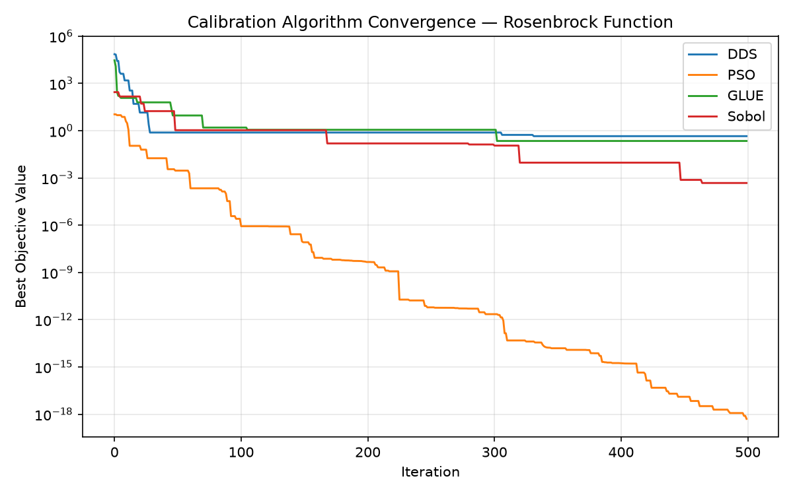

<!-- fingerprint:a90aa18c8fd3ced157c2cee08c6cb713 -->
# Calibration Algorithm Benchmarks

*Last updated: 2026-10-30 09:50 UTC*

Synthetic benchmark on the **Rosenbrock** test function f(x,y) = (1−x)² + 100·(y−x²)²  with random starting points.

| Algorithm | Iterations | Best Objective | Convergence Rate |
|-----------|-----------|----------------|------------------|
| DDS | 500 | 3.471102e-03 | 99.45% |
| PSO | 500 | 1.372880e-20 | 100.00% |
| GLUE | 500 | 6.661883e-01 | 99.92% |
| Sobol | 500 | 6.582576e-04 | 99.62% |

*Convergence rate = fraction of total improvement achieved in the first 20% of iterations.*
